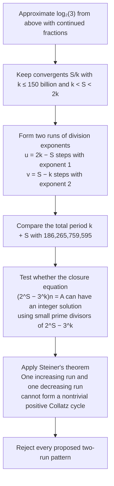

# BigCollatz

BigCollatz investigates positive Collatz cycles using algebraic equations.
It verifies individual cycle patterns, analyzes a symbolic family, and
enumerates cycle equations within explicit bounds.

## Lower bound for a nontrivial cycle

Any nontrivial positive Collatz cycle must contain **at least 72,057,431,991
odd steps** and have an **unaccelerated period of at least 186,265,759,595
steps**. The unaccelerated period counts both the odd operations `3n+1` and
the divisions by 2. These bounds are derived from convergence verification
below `2^71`. [Barina, *Improved verification limit for the convergence of
the Collatz conjecture* (2025)](https://doi.org/10.1007/s11227-025-07337-0).

To see how the verification gives a cycle bound, let `k` count odd steps
and `S` count divisions by 2. Each odd member `n` of a nontrivial cycle is
at least `2^71`. Multiplying the odd-to-odd updates around the cycle gives
`2^S = product(3 + 1/n)`, so
`log2(3) < S/k < log2(3) + 1/(3 * 2^71 * ln(2))`.
This interval lies strictly between the fractions
`103768467013/65470613321` and `10439860591/6586818670`.
Their cross products differ by one, so any fraction strictly between them
has numerator and denominator at least the respective sums. Thus
`S >= 114,208,327,604`, `k >= 72,057,431,991`, and the period `S + k`
has the lower bound above.

## Symbolic cycle search

`collatz-algebra` verifies exponent patterns given as compressed JSON words.
Exact verification requires both the odd-step count and the number of
divisions by 2 to fit a configurable work bound. The symbolic search uses a
theorem to decide the two-run family. See [the algebraic
model](ALGEBRAIC_PROJECT.md) for the proof and scope of each method.

Ask whether the included billion-scale example is eligible for exact checking:

```bash
python -m collatz_algebra.cli examples/billion_period_word.json
```

The example exceeds the default work bound. The command emits `not_tested`
and exits with status `2` before expanding its repetitions.
For eligible JSON words, status `0` means a confirmed cycle and status `1` means
an exact rejection. `--exact-work-limit` configures the admission bound; both the
odd-step count and total divisions must fit it.

Run the symbolic two-run search with a ceiling of 150 billion odd steps
and the lower bound on the unaccelerated period:

```bash
python -m collatz_algebra.cli --search-two-run 150000000000 --minimum-period 186265759595
```



Here `k` counts odd steps, `S` counts divisions by 2, and `A` is the constant
from composing the updates in the proposed pattern. The first proposal that meets the period bound has 137,528,045,312 odd steps and 355,504,839,929
total steps. The period and congruence checks give additional reasons for
rejection, and Steiner's theorem decides the entire two-run family.
See [the symbolic analysis](ALGEBRAIC_PROJECT.md#symbolic-two-run-family).

## Setup and tests

BigCollatz requires Python 3.11 or newer and has no runtime dependencies.

```bash
python -m pip install -e .
python -m unittest discover -v
```

## Validate the exact cycle-equation search

Use the known cycle `1 -> 4 -> 2 -> 1` as a positive control:

```bash
python -m bigcollatz search-cycles trivial-check \
  --max-odd-period 1 \
  --max-total-divisions 2 \
  --include-trivial
```

The search enumerates positive exponent vectors `(a_0, ..., a_{k-1})` for
`T(n) = (3n + 1) / 2**v2(3n + 1)`. Composition gives the exact candidate
`n = A / (2**sum(a_i) - 3**k)`.

A sum-constrained necklace recursion enumerates primitive exponent words
using their lexicographically least rotation. The enumerator starts at the
positivity boundary `2**S > 3**k` and uses small-prime divisibility tests
to reject impossible closure equations before constructing large numerators.

Use `--include-trivial` to include the cycle `1 -> 4 -> 2 -> 1`.
Progress is atomically checkpointed under `results/<search-id>/checkpoint.json`,
rerunning the same command resumes it or returns the completed result. Use
`--shard-count N --shard-index I` to split the deterministic enumeration among
independent processes or machines. Each shard needs a distinct search ID.

The enumerator is practical for small validation ranges. The number of
positive compositions grows combinatorially, which makes direct enumeration
at the lower bound for nontrivial cycles impractical.
